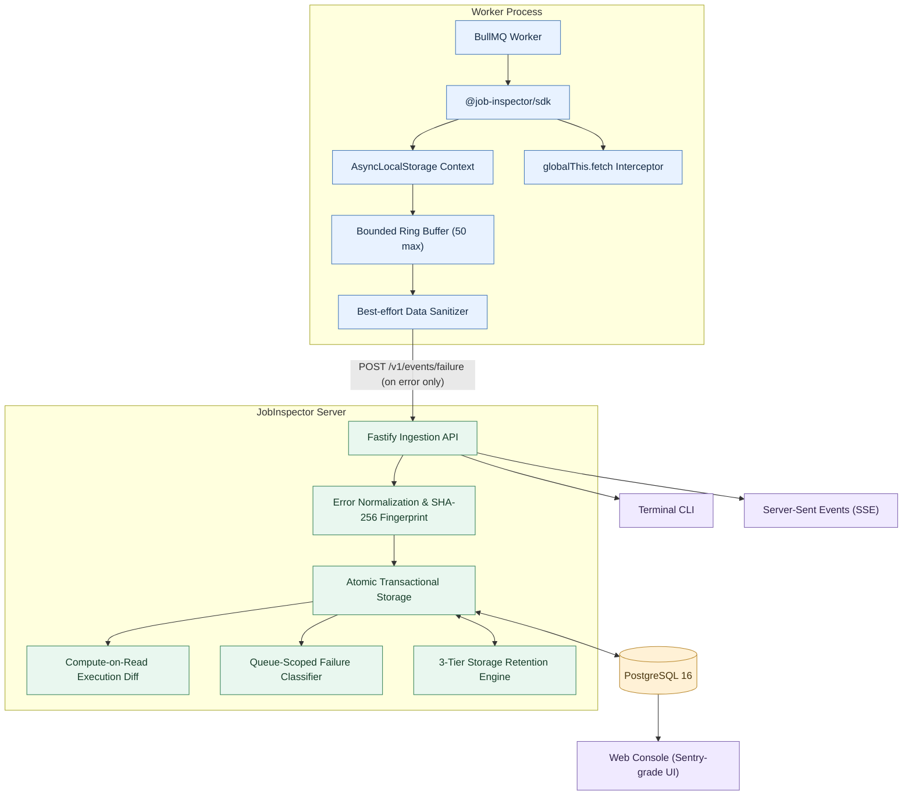

<div align="center">

# ⚡ JobInspector

### Understand what changed when a background job failed.
An open-source debugging and observability tool for Node.js background jobs.

JobInspector records execution breadcrumbs, captures failed attempts, and compares recorded execution history to help developers investigate failures across retries.

[Why JobInspector?](#the-problem) ·
[Features](#what-it-does) ·
[Architecture](#architecture) ·
[Getting Started](#getting-started) ·
[Development Status](#development-status) ·
[Contributing](#contributing)

</div>

---

**Project status:** Under active development. The current focus is Node.js, TypeScript, and BullMQ. See [Development Status](#development-status) for what is implemented and what is still planned.

---

## The Problem

Background jobs are executed asynchronously, detached from the HTTP request that enqueued them. When a job fails in a worker process and the queue engine retries it, the final error message often obscures what happened during earlier attempts.

Consider a common e-commerce scenario:
1. A worker sends an HTTP request to an external payment provider.
2. The request times out, even though the provider may have processed the charge.
3. BullMQ retries the job.
4. The second attempt crashes immediately with a database constraint error because the first attempt partially wrote records before timing out.

The final exception (`UniqueConstraintViolation`) is visible in standard error trackers, but it does not explain how execution reached that state.

### Where Existing Tools Fall Short for Queues

* **Traditional APMs (Datadog, New Relic):** Designed for distributed tracing across every transaction. In high-throughput queues (50,000 jobs/minute), recording 100% of executions generates massive network overhead and high cloud bills, even though 99% of jobs succeed without issue.
* **Error Trackers (Sentry, Bugsnag):** Capture stack traces and global application breadcrumbs, but lack first-class concepts of **queue lifecycles**, **retry state correlation**, and **attempt divergence**. Attempt 1 and Attempt 2 are often grouped as separate, disconnected issues.
* **Queue Dashboards (Bull-Board):** Report macro metrics (waiting, active, failed counts), but provide no forensic visibility into what the worker was doing internally at the millisecond of the crash.

When debugging a queue failure, developers need to answer:
* Did the retry fail at the same step as the previous attempt?
* What external HTTP calls or checkpoints ran immediately before the crash?
* Did the execution path or duration change between retries?
* Is this failure isolated to one specific payload (a poison pill), or are multiple distinct jobs failing with the same error across the queue?

JobInspector is built to make this recorded context structured, explainable, and accessible.

---

## What It Does

### 1. Records In-Memory Execution Breadcrumbs
Each instrumented job execution maintains an in-memory, circular ring buffer for diagnostic events using Node.js `AsyncLocalStorage`. These events include developer checkpoints and supported outgoing HTTP network activity.

* The default buffer holds up to **50 events**.
* When the buffer fills, older events are safely discarded, and the exact number of `droppedBreadcrumbs` is tracked to prevent memory leaks and unaligned diffs.
* **Zero network overhead on success:** If a job completes without throwing an error, the in-memory buffer is discarded. Telemetry is transmitted *only* on failure (tail-based sampling).

### 2. Captures Failed Attempts Idempotently
The SDK wraps a BullMQ job processor with a higher-order function (`wrapJob`). When an error occurs:
* The SDK captures job metadata, duration, error details, and recorded breadcrumbs.
* Network deliveries from the SDK are fail-safe and do not mask the worker's original error.
* The ingestion server processes attempts inside an atomic PostgreSQL transaction with monotonic updates (`Math.max`), ensuring late-arriving retries never downgrade parent job metadata. Duplicate deliveries are handled idempotently.

### 3. Compares Recorded Attempts (Compute-on-Read Diffing)
Rather than writing pre-computed diffs to database columns that can be corrupted by out-of-order retries, JobInspector dynamically evaluates the difference between attempts on read. 

Depending on the recorded data, the comparison reports observable facts:
* **Error Shift:** The recorded error name or fingerprint changed between attempts.
* **Timing Delta:** The recorded duration changed (for example, Attempt 2 exited 2,800 ms earlier).
* **Sequence Differences:** Breadcrumbs diverged at a specific step index, or one sequence ended earlier along the same path (`CURRENT_ENDS_EARLIER`).
* **Ordering Differences:** The exact same operations executed in a different order (such as non-deterministic `Promise.all` resolution), reported as `REORDERED` rather than falsely flagged as identical or diverged.
* **Tail Alignment:** If either attempt overflowed its 50-event buffer, the engine avoids offset-corrupted index matching and compares the trailing events backwards from the crash (`stepsFromEnd`).

*Note: These comparisons provide observable debugging clues; they do not claim to definitively identify the root cause.*

### 4. Groups Recurring Failure Patterns
The server classifies failures using their normalized SHA-256 fingerprints and recent queue history:
* **`SHARED_INCIDENT`:** The same error fingerprint appears across multiple distinct jobs ($\ge 3$) in the queue within a 5-minute historical window (indicating a shared database, network, or third-party API degradation).
* **`REPEATED_SAME_ERROR`:** A single job repeatedly fails with the exact same fingerprint across retries, while other jobs in the queue succeed (indicating a poisoned payload or corrupted entity state).
* **`ISOLATED_OR_NEW_ERROR`:** First occurrence of this fingerprint; no matching cluster found.

*Note: These labels describe observed patterns in recent history; they do not prove that an infrastructure component is down.*

### 5. Best-Effort Sensitive Data Redaction
The SDK includes an in-memory sanitizer that runs before telemetry leaves the worker process:
* **Key-Based Redaction:** Replaces values for keys matching `/password|token|secret|auth|api_key|credit_card|cookie|session/i` with `[REDACTED]`.
* **Value-Based Regex:** Matches recognizable token patterns like Bearer tokens and live Stripe keys (`sk_live_...`).
* **Object Preservation:** Preserves `Date` instances as ISO strings, summarizes `Buffer` instances (`[BUFFER: X bytes]`), preserves `Error` names and messages, truncates strings longer than 1,000 characters, and protects against call-stack crashes on circular references using a `WeakSet`.

*Important: Sanitization is best-effort and cannot guarantee that every secret or personal data element is removed. Review what your application logs before using JobInspector with sensitive workloads.*

---

## Architecture

The diagram below shows the main data flow: the SDK runs alongside a BullMQ worker, reports failures to the API, and the server exposes recorded information through a web console, terminal CLI, and real-time Server-Sent Events (SSE) stream.



---

## Technology Stack

| Component | Technology | Description |
| :--- | :--- | :--- |
| **Language** | TypeScript (ESM) | End-to-end type safety across packages |
| **Job Queue** | BullMQ | Target background queue ecosystem |
| **Execution Context** | Node.js `AsyncLocalStorage` | Isolates concurrent in-flight job breadcrumbs |
| **Ingestion Server** | Fastify | High-throughput, low-overhead HTTP engine |
| **Database & ORM** | PostgreSQL 16 + Prisma | Relational tables with compound indexes & JSONB |
| **Storage Hygiene** | PostgreSQL `SKIP LOCKED` | 3-tier non-blocking batch retention worker |
| **Local Infrastructure** | Docker Compose + Redis | Local testbed for Redis and PostgreSQL |
| **Web Console** | React + Tailwind CSS | Sentry-style UI with Dark, Light, and Claude Warm themes |
| **Monorepo Tooling** | pnpm Workspaces | Strict dependency isolation without phantom imports |

---

## Getting Started

These steps guide running the repository locally for development or evaluation.

### Prerequisites
* **Node.js:** v20.0.0 or later
* **Package Manager:** `pnpm` (v9+)
* **Containers:** Docker and Docker Compose (for local PostgreSQL & Redis)

### 1. Clone and Install
```bash
git clone https://github.com/byte-curious/JobFailure_Inspector.git
cd JobFailure_Inspector

pnpm install
```

### 2. Start Local Infrastructure
Start PostgreSQL (port `5432`) and Redis (port `6379`) in the background:
```bash
pnpm infra:up
```

### 3. Apply Database Schema
Push the Prisma schema to your local PostgreSQL instance:
```bash
pnpm --filter @job-inspector/server exec prisma db push
```

### 4. Start the Ingestion & Inspection Server
```bash
pnpm dev:server
```
The server will boot on `http://localhost:3000`. It serves both the **REST API**, the **Server-Sent Events stream**, and the **Web Console**.

---

## Example Usage

Wrap an existing BullMQ processor with `wrapJob`. The wrapper intercepts uncaught exceptions, records outgoing `fetch` calls, and flushes diagnostics only when a job fails:

```typescript
import { Worker } from "bullmq";
import { wrapJob, inspector } from "@job-inspector/sdk";

const worker = new Worker(
  "invoice-queue",
  wrapJob(async (job) => {
    // 1. Optional manual checkpoint
    inspector.checkpoint("Validating customer account balance");

    // 2. Outgoing fetch calls are automatically recorded!
    const response = await fetch("https://api.stripe.com/v1/charges", {
      method: "POST",
      headers: { "Content-Type": "application/json" },
      body: JSON.stringify({
        amount: job.data.amount,
        apiKey: job.data.apiKey, // Automatically redacted if failure occurs
      }),
    });

    if (!response.ok) {
      throw new Error(`Payment gateway rejected charge with status ${response.status}`);
    }
  }),
  { connection: { host: "localhost", port: 6379 } }
);
```

---

## Inspecting Failures

JobInspector provides two developer interfaces: a **Terminal CLI** and a **Web Console**.

### 1. The Terminal CLI (`packages/cli`)
For developers who prefer working in their terminal:

```bash
# List recent failures across queues
pnpm --filter @job-inspector/cli dev list

# Filter by queue or status
pnpm --filter @job-inspector/cli dev list --queue invoice --status FAILED

# Inspect a specific job's execution diff, timeline, and payload
pnpm --filter @job-inspector/cli dev inspect <job-uuid>
```

### 2. The Web Console (`packages/web`)
Open **`http://localhost:3000`** (or `http://localhost:5173` during local frontend development):
* **Issues Stream:** Real-time table with queue filtering, search, and a floating bulk action bar (`Resolve`, `Ignore`, `Re-enqueue`).
* **Issue Detail View:** High-density forensic view showing Attempt 1 vs. Attempt 2 execution diffs, interactive breadcrumbs with status pills, collapsible stack traces, and copyable sanitized JSON payloads.
* **Queue Health & Storage Retention:** Real-time 24-hour failure spikes histogram from PostgreSQL, per-queue health status, and a 3-tier storage retention monitor.
* **Theme Support:** Switch between **Sentry Dark** (midnight violet), **Clean Light** (high-contrast black text on white), and **Claude Warm** (papyrus neutral).

---

## Development Status

JobInspector is being developed incrementally. This table reflects the project's current intended status:

| Area | Status | Description |
| :--- | :--- | :--- |
| **BullMQ Wrapper & Failure Reporting** | Implemented | Higher-order function catching errors and extracting attempt counts |
| **Bounded Breadcrumb Buffer** | Implemented | 50-item in-memory ring buffer tracking `droppedBreadcrumbs` |
| **AsyncLocalStorage Context** | Implemented | Concurrency-safe trace isolation across parallel worker jobs |
| **HTTP Fetch Instrumentation** | Implemented | Automatic `globalThis.fetch` interception measuring status and timing |
| **Best-Effort Data Sanitization** | Implemented | Key/regex matching, `Date`/`Buffer`/`Error` guards, `WeakSet` circular protection |
| **Transactional Failure Ingestion** | Implemented | Single-transaction monotonic parent updates (`Math.max`) and duplicate safety |
| **Error Normalization & Fingerprinting** | Implemented | Regex pipeline stripping dynamic IDs while preserving SQLSTATE and HTTP codes |
| **Attempt Comparison (Diff Engine)** | Implemented | Compute-on-read diffing with discriminated unions and tail backwards alignment |
| **Queue-Scoped Failure Classifier** | Implemented | 5-minute rolling window blast radius analysis (`SHARED_INCIDENT`, `REPEATED_SAME_ERROR`) |
| **3-Tier Storage Retention Engine** | Implemented | Hot (0–7d), Warm (8–30d JSON strip), Cold (30d+ batch delete with `SKIP LOCKED`) |
| **Terminal CLI Tool** | Implemented | Formatted ASCII tables and forensic inspection in terminal |
| **Web Console Dashboard** | Implemented | Multi-page Sentry-style UI with real-time Server-Sent Events |
| **Incident-Based Webhook Outbox** | In Progress | Slack Block Kit and Discord alerts with deduplication, cooldown, and recovery |
| **Failure Artifact Export** | Planned | CLI export of sanitized failure bundles (`failure-bundle.json`) |
| **Local Diagnostic Replay Runner** | Planned | Re-run local handlers with recorded HTTP fixtures and mock dependencies |

*“Implemented” describes work present in the codebase; it does not imply universal production readiness across all possible queue topologies.*

---

## Running Tests

Automated testing is performed using Node.js's native test runner (`node:test`):

```bash
# Run SDK unit tests (RingBuffer, Concurrency Isolation, Sanitizer edge cases)
pnpm --filter @job-inspector/sdk test

# Run Server unit & integration tests (Normalizer, Diff Engine, Classifier, Retention, Gauntlet)
pnpm --filter @job-inspector/server test
```

Currently passing **30+ automated tests** covering:
* Chronological FIFO eviction in bounded buffers.
* Context leakage prevention during parallel asynchronous tasks.
* Circular reference handling without call-stack exhaustion.
* Monotonic updates on out-of-order attempt deliveries.
* Queue isolation in 5-minute incident classification queries.
* Non-blocking batch deletion using PostgreSQL `FOR UPDATE SKIP LOCKED`.

---

## Current Limitations

* **Integration Scope:** The current SDK implementation focuses specifically on **BullMQ** in Node.js environments. Support for Celery, SQS, or other queue managers is not currently provided.
* **Observability Boundaries:** Comparisons depend strictly on recorded events. JobInspector cannot reconstruct function calls, database mutations, or network operations it was not instrumented to observe.
* **Sanitization Boundaries:** Sanitization is best-effort. It relies on known keywords, regex patterns, and standard structural types. It cannot guarantee that arbitrary, domain-specific sensitive data will never appear in recorded traces.
* **Diagnostic Signals:** Failure classifications (`SHARED_INCIDENT`, `REPEATED_SAME_ERROR`) describe observed patterns in recent history; they should be treated as diagnostic triage clues, not definitive proofs of external outages.

---

## Roadmap

- [x] BullMQ wrapper and fail-safe failure reporting
- [x] In-memory execution breadcrumbs with overflow tracking
- [x] Automated zero-code HTTP `fetch` interception
- [x] Client-side PII and credential sanitization with circular reference protection
- [x] Deterministic error normalization and SHA-256 fingerprinting
- [x] Compute-on-read execution diff engine (with prefix and tail backwards alignment)
- [x] Queue-scoped blast radius failure classification
- [x] 3-Tier non-blocking storage retention engine (Hot, Warm, Cold)
- [x] Terminal CLI tool (`list` and `inspect`)

- [ ] Incident-based transactional webhook outbox (Slack Block Kit, Discord Embeds)
- [ ] Global alert rate-capping and auto-recovery notifications
- [ ] Failure artifact export (`npx job-inspector pull <id>`)
- [ ] Local replay runner executing worker code against recorded HTTP fixtures

---

## Contributing

Contributions, bug reports, and feedback are welcome. You do not need to know the entire codebase to help.

### Ways to Contribute
* **Report Bugs:** Open an issue with a minimal reproduction and the relevant error output.
* **Improve Test Coverage:** Add edge cases for the ring buffer, sanitizer, or attempt comparison engine.
* **Instrumentation Plugins:** Suggest or contribute auto-interceptors for additional database clients (e.g. `pg`, Prisma middleware) or HTTP clients.
* **UI Improvements:** Enhance keyboard navigation, data density, or theme contrast in the web dashboard.

### Local Development Workflow
1. Fork the repository and clone your fork.
2. Install dependencies with `pnpm install`.
3. Create a branch: `git checkout -b feat/describe-your-change`.
4. Make changes and add or update relevant tests.
5. Run the test suites: `pnpm --filter @job-inspector/server test` and `pnpm --filter @job-inspector/sdk test`.
6. Commit and push your branch, then open a pull request explaining what changed and why.

---

## License

JobInspector is distributed under the **MIT License**. See [LICENSE](./LICENSE) for full details.

```
