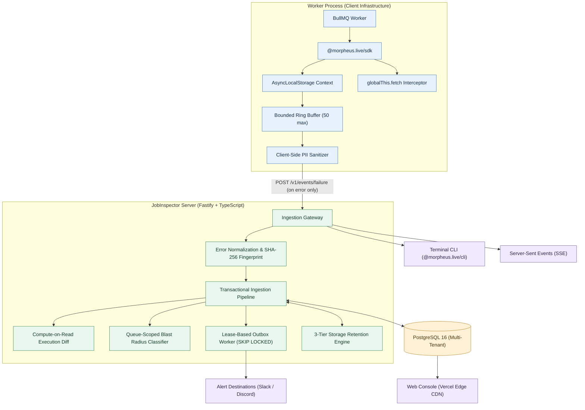

# ⚡ JobInspector

### The Black Box Flight Recorder & Forensic Triage Engine for Distributed Background Jobs

An open-source observability and diagnostic platform for asynchronous workers.

Zero telemetry network overhead on success. When a worker fails, inspect execution diffs, triage queue blast radiuses, and replay failures locally with zero cloud dependencies.

[Live Platform](https://job-failure-inspector.vercel.app) · [Documentation](https://job-failure-inspector.vercel.app/docs) · [Live Console](https://job-failure-inspector.vercel.app/console) · [npm Package](https://www.npmjs.com/package/@morpheus.live/sdk) · [License](./LICENSE)

[](https://opensource.org/licenses/MIT)
[](https://www.npmjs.com/package/@morpheus.live/sdk)
[](https://nodejs.org/)
[](https://www.postgresql.org/)
[]()

---

## 🛑 The Problem: The Asynchronous Observability Gap

Background jobs run asynchronously, detached from the HTTP requests that enqueued them. When a job fails in a worker process and the queue engine retries it, traditional monitoring tools create critical blind spots:

- **The Retry Blindspot:** Attempt 1 writes to the database and times out contacting a third-party API. Attempt 2 fails immediately with a `UniqueConstraintViolation`. Standard error trackers log only the second error, completely obscuring the original root cause.

- **The Egress Tax:** Traditional APMs (Datadog, New Relic) trace transactions over the network. In high-throughput queues processing 50,000 jobs per minute, logging every successful execution can create significant cloud bandwidth and ingestion costs, even when most jobs succeed without issue.

- **The Poison Pill Dilemma:** When 200 jobs fail at 2:00 AM, queue dashboards cannot tell you whether a shared database connection pool is exhausted (an infrastructure outage) or a single malformed user payload is retrying in an infinite loop (a poison pill).

JobInspector bridges this gap by acting as a dedicated **flight data recorder** engineered specifically for queue lifecycles.

---

## ⚡ What JobInspector Does

### 1. In-Memory Ring Buffer & Zero-Egress-on-Success Sampling

Each instrumented job execution maintains a circular in-memory buffer capped at 50 events using Node.js `AsyncLocalStorage`.

- **Zero Network Egress on Success:** If a job completes without throwing, the in-memory buffer is discarded. Telemetry is transmitted *only* on failure (tail-based sampling).
- **Automatic Boundary Tracing:** Automatically intercepts outgoing `globalThis.fetch` calls, measuring endpoints, HTTP methods, response status codes, and durations without requiring manual loggers.

### 2. Compute-on-Read Forensic Retry Diffing

Rather than storing static diffs that can be affected by out-of-order deliveries, JobInspector dynamically compares Attempt N against earlier attempts when queried.

- **Root-Cause Shift Detection:** Highlights when the error name or fingerprint shifts across retries (e.g. `StripeTimeout` → `UniqueConstraintViolation`).
- **Duration Deltas:** Quantifies execution time changes (e.g. `-2,800ms` when a retry crashes earlier along the code path).
- **Async Reordering Awareness:** Detects when the same tasks resolve in a different order due to non-deterministic `Promise.all` scheduling, reporting `REORDERED` instead of false divergence.
- **Tail Alignment:** If buffers overflowed, aligns execution histories backwards from the crash using `stepsFromEnd`.

### 3. Queue-Scoped Blast Radius Classifier

Evaluates each failure against a 5-minute rolling window within its specific queue.

- **`SHARED_INCIDENT`:** ≥ 3 distinct jobs failed with the exact same error fingerprint in the last 5 minutes, potentially indicating an upstream database or third-party API outage.
- **`REPEATED_SAME_ERROR`:** A single job repeatedly fails its retries with the same error, while other jobs in the queue succeed (a poison pill payload).
- **`ISOLATED_OR_NEW_ERROR`:** First occurrence of this error; potentially an isolated or transient failure.

### 4. Calm Incident-Based Transactional Outbox

Reduces notification spam through an outbox pipeline backed by PostgreSQL `FOR UPDATE SKIP LOCKED` leases.

- **Anti-Spam Throttling:** Suppresses notifications on transient first-attempt retries that self-heal. Alerts fire on dead letters, outages, or confirmed repeated failures.
- **Rich Native Cards:** Dispatches Slack Block Kit cards and Discord Rich Embeds with direct dashboard links.
- **Auto-Recovery Notices:** Automatically detects when a queue has been quiet for 15 minutes and emits a resolution notice.

### 5. Client-Side Data Scrubbing (DLP)

Runs in memory on your worker machine before data ever touches the network.

- Key-name redaction for passwords, tokens, API keys, cookies, and sessions.
- Regex pattern matching for live Stripe keys (`sk_live_...`) and Bearer JWTs.
- Preserves `Date` objects as ISO strings, summarizes binary `Buffer` instances, and handles circular references using a native `WeakSet`.

### 6. Diagnostic Local Replay Engine

Reproduce production failures locally.

- Download a failure artifact bundle (`.replay.json`) using the CLI.
- Run your local worker code against the bundle. The local runner can stub outgoing HTTP calls using recorded production responses, preventing third-party APIs (Stripe, Twilio) from being called again during local debugging.

---

## 🏗 System Architecture



---

## 🚀 Quickstart

### 1. Install the Worker SDK

```bash
npm install @morpheus.live/sdk

# or

pnpm add @morpheus.live/sdk
```

### 2. Wrap Your BullMQ Worker

Wrap your existing worker processor with `wrapJob`. Your business logic remains unchanged.

```typescript
import { Worker } from "bullmq";
import { wrapJob, inspector } from "@morpheus.live/sdk";

const worker = new Worker(
  "invoice-processing",
  wrapJob(async (job) => {
    // 1. Optional manual checkpoint
    inspector.checkpoint("Validating customer tax jurisdiction");

    // 2. Outgoing fetch requests are intercepted automatically
    const response = await fetch("https://api.stripe.com/v1/charges", {
      method: "POST",
      headers: { "Content-Type": "application/json" },
      body: JSON.stringify({
        amount: job.data.amount,
        apiKey: job.data.apiKey, // Client-side sanitized if failure occurs
      }),
    });

    if (!response.ok) {
      throw new Error(
        `Payment gateway rejected with status ${response.status}`
      );
    }
  })
);
```

### 3. Add Environment Variables

In your worker server's `.env`:

```env
INSPECTOR_INGESTION_URL="https://job-failure-inspector.vercel.app/v1/events/failure"
INSPECTOR_API_KEY="insp_live_your_private_project_key"
```

---

## 🏢 Multi-Tenant Company Setup & Private Alerts

JobInspector provides project-level isolation between organizations.

1. **Sign In:** Go to [JobInspector](https://job-failure-inspector.vercel.app) and sign in via GitHub, Google, or Email. Your private project workspace is provisioned automatically.

2. **Add Your Webhook:** Navigate to Settings (⚙️) → Webhook Alert Integration. Paste your team's Discord or Slack webhook URL and click **Save Webhook URL**.

3. **Copy Your Key:** Copy your Project API Key (`insp_live_...`) into your worker's `.env`.

4. **Project Isolation:** Failures are associated with your `projectId`. Alerts are routed to your configured webhook. Other organizations cannot access your project's queues or traces.

---

## 📟 Terminal CLI Reference

For developers who prefer investigating failures directly in the terminal:

### List Recent Failures

```bash
npx @morpheus.live/cli list
```

### Filter by Queue and Failure Status

```bash
npx @morpheus.live/cli list --queue invoice --status FAILED
```

### Inspect a Specific Failure

View retry diffs, blast radius, and payload:

```bash
npx @morpheus.live/cli inspect <job-uuid>
```

### Download a Failure Artifact

Download a `.replay.json` artifact to your laptop:

```bash
npx @morpheus.live/cli pull <job-uuid> --out ./debug-job.json
```

### Replay a Failure Locally

Replay the crash against your local code with mocked network stubs:

```bash
npx @morpheus.live/cli replay --file ./debug-job.json --handler ./src/workers/invoice.ts
```

### Open the Web Console

Open the web console in your browser (defaults to port 3000):

```bash
npx @morpheus.live/cli studio
```

---

## 📂 Starter Examples (`examples/`)

Runnable starter templates are available in the `examples/` directory.

- **`examples/basic-bullmq`:** Complete BullMQ worker showing automatic HTTP interception, manual checkpoints, and failure reporting with `@morpheus.live/sdk`.

---

## 🧪 Testing & Reliability

The platform is verified with 56 automated unit and integration tests using Node.js's native test runner (`node:test`).

### Run All Tests

```bash
pnpm test
```

### Run SDK Unit Tests

Covers RingBuffer, concurrency isolation, and sanitizer:

```bash
pnpm --filter @morpheus.live/sdk test
```

### Run Server Tests

Covers normalizer, diff engine, classifier, retention, and outbox:

```bash
pnpm --filter @job-inspector/server test
```

### Test Coverage Includes

- Bounded circular memory eviction and chronological ordering.
- AsyncLocalStorage context isolation across concurrent worker tasks.
- Circular object handling and buffer memory explosion prevention.
- Monotonic updates on out-of-order attempt deliveries (`Math.max`).
- Multi-tenant query isolation and compound index verification.
- Non-blocking batch deletion using PostgreSQL `FOR UPDATE SKIP LOCKED`.

---

## 🗺 Strategic Capabilities & Future Scope

We are actively expanding JobInspector. If you are interested in contributing, here are some planned architectural areas:

- **Multi-Queue Adapters:** Native instrumentation wrappers for AWS SQS, RabbitMQ (`amqplib`), Temporal, and a Python SDK for Celery.
- **Deep Database Auto-Instrumentation:** Zero-code query interception for Prisma middleware, PostgreSQL `pg` pool, and `ioredis`.
- **Enterprise DLP & High-Entropy Secret Detection:** Shannon entropy-based token scanning to catch unstructured secrets and custom per-queue redaction rules.
- **Automated Cloud Root-Cause Correlation:** Cross-referencing worker failures with database connection pool saturation metrics and external cloud status pages (Stripe, AWS).

---

## 🤝 Contributing

Contributions are warmly welcome!

1. Fork the repository on GitHub.
2. Clone your fork locally:

```bash
git clone https://github.com/your-username/JobFailure_Inspector.git

cd JobFailure_Inspector

pnpm install

pnpm infra:up
```

3. Create a feature branch:

```bash
git checkout -b feat/my-feature
```

4. Run tests to verify zero regressions:

```bash
pnpm test
```

5. Open a Pull Request explaining what changed and why.

---

## 📄 License

JobInspector is distributed under the MIT License. See [LICENSE](./LICENSE) for details.

